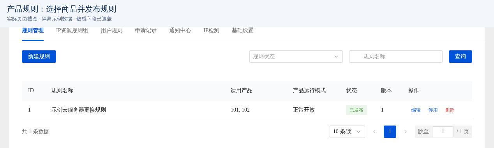
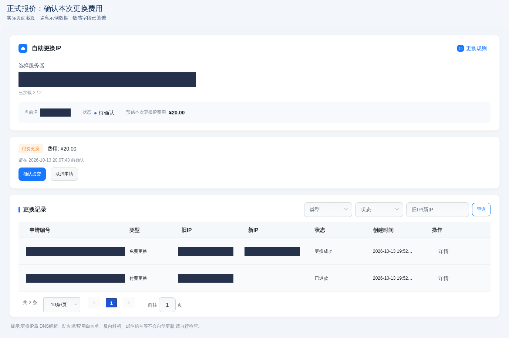
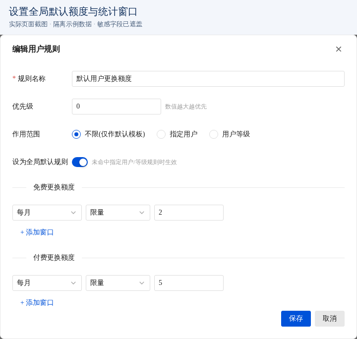
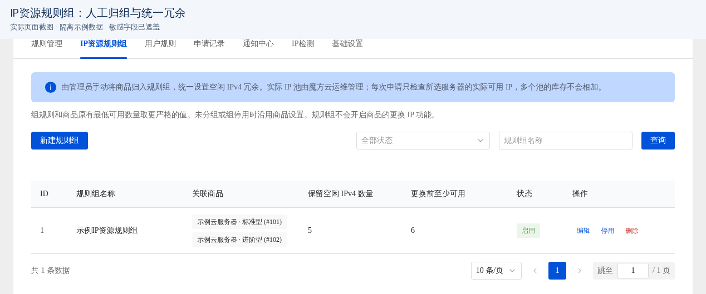
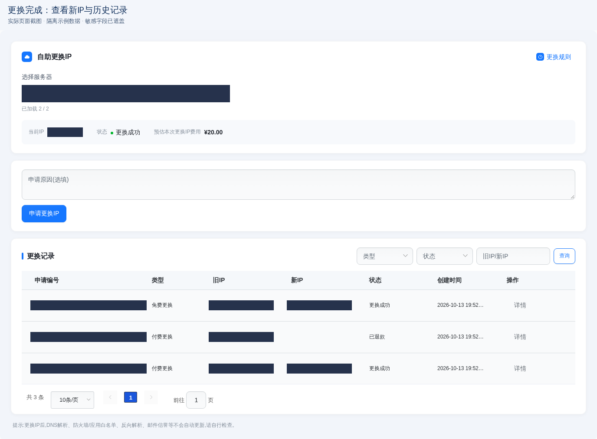

# 自助更换 IP · Cr

**为智简魔方 V10 的魔方云服务器提供自助主 IPv4 更换**

客户自助申请 · 免费与付费额度 · 库存约束和审核留痕

  

**[使用指南](docs/使用指南.md) · [界面预览](#界面预览) · [交流与反馈](#交流与反馈) · [相关项目](#相关项目)**

[功能亮点](#功能亮点) · [快速开始](#快速开始) · [适用范围](#适用范围)

## 关于自助更换 IP

客户可以选择本人名下符合规则的服务器，查看更换额度和费用，再提交申请。商家按商品配置自助条件、计价和审核方式，并用资源规则控制更换后保留的可用 IP 数量。

## 功能亮点

- **商品规则**支持按商品制定免费或付费方案，配置更换价格、最低资源要求和审核条件。
- **客户额度**可设置月、季度、年或累计额度，分别管理免费与付费次数。
- **资源管理**按资源规则组控制可选范围和库存冗余，避免资源不足时继续受理。
- **申请与结算**客户确认报价后使用 V10 原生订单流程，后台可查看审核、执行、退款和结果核对记录。
- **运营跟踪**提供更换历史、用户统计、分类日志和脱敏通知记录，可针对单条通知操作。

## 界面预览

点击查看大图。截图使用演示数据，服务器标识和地址已遮盖。

| 客户查看更换报价 | 后台配置客户额度 |
| :---: | :---: |
|  |  |
| **IP 资源规则组** | **客户查看更换记录** |
|  |  |

## 快速开始

1. 向开发者获取 **2.2.4** 安装包，通过 V10 应用管理安装。
2. 在插件基础设置检查环境，再设置商品规则、IP 资源规则和用户额度。
3. 发布规则后，使用测试会员确认产品可选、报价和审核流程。
4. 在「申请记录」查看订单、更换结果和异常处理状态。

[安装、后台配置与会员操作](docs/使用指南.md)

## 适用范围

已验证环境为 V10 10.7.4、魔方云模块 4.2.0 和 PHP 7.4。支持经典网络下处于正常状态的单台云服务器主 IPv4 更换。附加 IPv4 与 IPv6 保留，VPC 和批量更换不在当前范围内。

## 相关项目

| 项目 | 用途 |
| --- | --- |
| [酷锐 A1 主题（CRA1）](https://github.com/zbxh/cra1-theme-public) | 智简魔方 V10 的官网、会员中心与购物车主题。 |
| [赠金](https://github.com/zbxh/cr-gift-credit-showcase) | 按规则发放独立赠金，在适用订单中自选金额抵扣。 |
| [补货订阅](https://github.com/zbxh/cr-stock-subscribe) | 开源插件，提供商品补货订阅、下架提醒和通知管理。 |
| [产品兑换码](https://github.com/zbxh/cr-product-redeem-showcase) | 按配置创建兑换批次，客户凭码开通服务器。 |
| [统一到期日期](https://github.com/zbxh/cr-unified-expiry-showcase) | 将多台服务器的到期日调整到同一日号，方便集中续费。 |

## 交流与反馈

- **开发者 Cr** · QQ **793305720** · QQ 群 **603107399**。[加入交流群](https://qm.qq.com/q/O3d7bVtcoS)
- 反馈时请附插件版本、魔方云模块版本和操作步骤。[提交问题](https://github.com/zbxh/cr-self-change-ip-showcase/issues/new)
